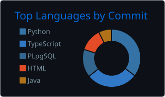

<h1 align="center">Hi, I'm Ömer Faruk 👋</h1>

  <b>Software Engineer @ Mina AI Solutions</b> · Computer Vision · AI Chatbots · Full-Stack

  
  
  
  

---

### 🧠 About me

- 🤖 Building **AI solutions for businesses** at Mina AI Solutions (Bilişim Vadisi): computer-vision-based **defect detection** and **person recognition** systems, plus **AI-powered chatbots** for client companies.
- 🏭 Previously digitized factory-floor machinery at **UZER Makina** and **KOLSAN** with C# / ASP.NET Core, Node.js and MSSQL.
- 🎓 Computer Engineering graduate, **Kocaeli University**.
- 🚀 I like owning a product end to end: backend, frontend, Docker and the VPS it runs on.
- 📸 Off the keyboard: sports, historical places and photography.

---

### 🛠️ Tech stack

  
   
  

---

### 🌟 Featured projects

| Project | What it is | Stack |
|---|---|---|
| [**Bilişim Postası**](https://bilisimpostasi.com.tr) · [repo](https://github.com/OmerTuregun/bilisimpostasi.com.tr) | Automated bilingual (TR/EN) tech & AI news site run by an AI agent pipeline | n8n, Claude API, Astro, Docker |
| [**Hocanı Yorumla**](https://hocaniyorumla.com.tr) · [repo](https://github.com/OmerTuregun/hoca-puan) | Anonymous rating & review platform for university professors, with moderation | ASP.NET Core, React, PostgreSQL |
| [**LİVA Tournament**](https://github.com/OmerTuregun/liva) | Management platform for a 12-team, 117-player football tournament | .NET, TypeScript, PostgreSQL |
| [**Sign Language Recognition**](https://github.com/OmerTuregun/sign-language-recognition) | Real-time sign language letter recognition from a camera, trained on my own dataset | Python, Computer Vision |
| [**DocShift**](https://github.com/OmerTuregun/docshift) | AI-ready file processing app that parses Excel, Word, PDF and PowerPoint into structured text | TypeScript |

---

### 📊 GitHub stats

  

  
  

---

### ✍️ Latest posts on Medium

<!-- BLOG-POST-LIST:START -->
- [Docker Compose Nedir? Tek Komutla Tüm Servislerini Ayağa Kaldır!](https://medium.com/@trkuraf/docker-compose-nedir-tek-komutla-t%C3%BCm-servislerini-aya%C4%9Fa-kald%C4%B1r-3958377f133b?source=rss-4c1b6fe9097e------2)
- [Docker: Yazılım Geliştirmede Neden Bu Kadar Önemli?](https://medium.com/@trkuraf/docker-yaz%C4%B1l%C4%B1m-geli%C5%9Ftirmede-neden-bu-kadar-%C3%B6nemli-18b2e0b5a886?source=rss-4c1b6fe9097e------2)
<!-- BLOG-POST-LIST:END -->

---

<i>Open to collaborating on AI and full-stack projects. Feel free to reach out!</i>

